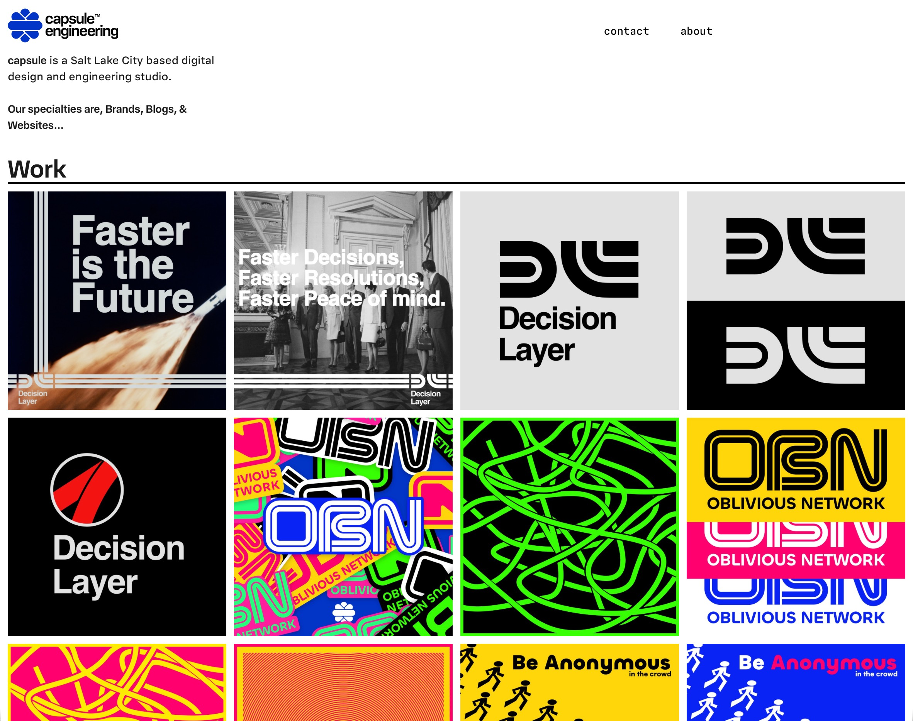

Capsule Engineering! What a great name. I even got the domain: capsule.engineering. I love it. 

I didn't want to go freelance again. I'm not good at it. Or at least I wasn't very good at it. I think this time It will turn out alright and I'm gonna *"make it"*. A couple of years ago I tried a subscription type freelance business thing and it didn't work out. unlimited service is really difficult when you're not charging enough and you're not good enough or fast enough. Nowadays I'm good, fast, and appropriately priced.

I'm trying to overdeliver. It works.

This is the studio site at the moment. I've actually done a TON of work in the last 3 months and I feel like I'm getting a lot better? I think. It's just hard to explain how much easier things feel. Not easier. Just I feel confident that I can do a good job and then I just don't quite until I do the job. That's a good feeling.

## So what's different?

I've gone freelance a number of times. Every time I decide that I'm better off not doing that and working for a company. Then the company has layoffs and I'm affected. The circle begins again.

I said: *"Fuck it!"* and I tried my best. I started offering free work to hopefully find some paid work, which worked out. Then I over delivered, and I did it as fast as I could. I figured if I had just one chance to make something good, maybe even great before looking for more work, then I better take it. My design portfolio was a little bare, so I really need to fill it, but with actual work.

I learned a lesson that has taken me years to figure out. Leave everything on the table.

I'm not sure how this is all gonna pan out. But I'm done not betting on myself. I'm not gonna look for a cozy stable job. The truth is that they are neither stable nor are they cozy. We've seen layoffs after mass layoffs. wealth inequality is at it's worst. Things are bad, they might get better. The people running tech think we're disposable. To stand out I think it means to go as hard and as fast as you can.

-kow

