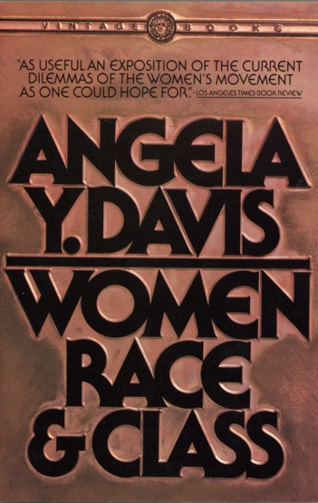
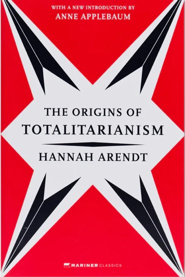

<columnsheader><h4>2026</h4></columnsheader>
<flex class="booksbox">
	
</flex>

<columnsheader><h4>2025</h4></columnsheader>
<flex class="booksbox">
	
	
	
	
</flex>

<columnsheader><h4>2024</h4></columnsheader>
<flex class="booksbox">
	
	
</flex>
